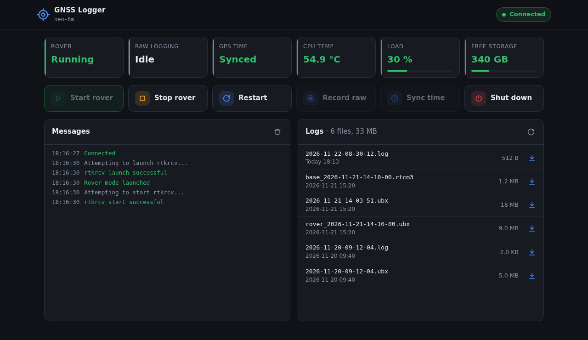

# Raspberry Zero GNSS Logger

A small, self-contained GNSS logger and RTK rover built on a **Raspberry Pi Zero** and a **u-blox receiver** (NEO-6M or ZED-F9P). It runs [RTKLIB](https://github.com/rtklibexplorer/RTKLIB) and is controlled from a web panel that you open from your phone or laptop in the field. You need no keyboard, no screen and no internet.



## Contents

- [What it does](#what-it-does)
- [Hardware](#hardware)
- [How it works](#how-it-works)
- [Installation](#installation)
- [Configuration](#configuration)
- [Using the control panel](#using-the-control-panel)
- [Downloading and processing data](#downloading-and-processing-data)
- [Repository layout](#repository-layout)
- [Troubleshooting](#troubleshooting)
- [Security](#security)
- [Credits and license](#credits-and-license)

## What it does

- **Raw data logging.** Records the receiver's raw UBX stream to a file with `str2str`, for post-processing (PPK).
- **RTK rover.** Runs `rtkrcv` with NTRIP corrections and serves the solution as NMEA over TCP.
- **GPS time synchronisation.** The Pi Zero has no real-time clock. When no network time is available, the clock is set from the receiver's UBX `NAV-TIMEUTC` message, so log file names and timestamps are correct.
- **Web control panel** with:
  - start, stop and restart for the rover;
  - start and stop for raw recording;
  - time sync;
  - device shutdown, with a confirmation dialog.
- **Live status:**
  - rover and recording state;
  - time sync state;
  - CPU temperature and load;
  - free storage.
- **File list and download.** Lists the log files with size and date, newest first, and refreshes it automatically.
- **Status LEDs** on GPIO, so you can see the state without opening the panel.
- **Mobile-friendly panel** with a light and dark theme. All assets are served locally, so it works without internet.

## Hardware

| Part | Notes |
|---|---|
| Raspberry Pi Zero / Zero W / Zero 2 W | Any Pi works; the Zero is used for its size and low power |
| u-blox NEO-6M **or** ZED-F9P | Connected to the Pi's UART (`/dev/serial0`) |
| GNSS antenna | Use a multi-band antenna for the ZED-F9P |
| 3 LEDs and resistors (optional) | Status indication |
| microSD card, power bank | |

### Wiring

| Receiver | Raspberry Pi |
|---|---|
| TX | GPIO15 / RXD (pin 10) |
| RX | GPIO14 / TXD (pin 8) |
| GND | GND (pin 6) |
| VCC | 3.3 V (pin 1) or 5 V (pin 2), depending on the module |

| LED | GPIO | Physical pin | Meaning |
|---|---|---|---|
| Green | GPIO5 | 29 | Rover is running |
| Blue | GPIO6 | 31 | Blinking: time sync in progress. Steady: time synced |
| Orange | GPIO13 | 33 | Rover failed to start |

> The receiver's UART must be set to **115200 baud**. The NEO-6M ships at 9600 and the ZED-F9P at 38400. Change the rate with u-center and save it to the receiver's flash or battery-backed RAM.

## How it works

```
 u-blox receiver ──UART──► /dev/serial0
                               │
          ┌────────────────────┴────────────────────┐
          │                                         │
   str2str (raw logging)                 rtkrcv (RTK rover)
   └► /home/pi/log/<time>.ubx            ├◄ NTRIP corrections (inpstr2)
                                         └► NMEA solution on TCP :27000
          ▲                                         ▲
          └──────────── rtkserver.py ───────────────┘
              Flask + Socket.IO web panel on port 80
              GPIO LEDs · GPS time sync · file downloads
```

- **`rtkserver.py`** is the web server. It starts and stops `str2str` as a subprocess and drives `rtkrcv` through its interactive console, using `pexpect`.
- Raw logging and the rover both use the serial port, so the panel only lets you run one at a time. Time sync also reads the serial port, so it is only available while both are stopped.

## Installation

The paths in the code and config files assume the user is **`pi`** and everything lives in `/home/pi`. Current Raspberry Pi OS images have no default user, so create `pi` in Raspberry Pi Imager when you write the card.

### 1. Operating system

Use **Raspberry Pi OS Lite (32-bit)**. The Trixie release is recommended: it ships every Python dependency as a package. Bookworm also works; see step 3.

Enable the UART and turn off the serial login console:

```sh
sudo raspi-config
# Interface Options → Serial Port
#   Login shell over serial?  → No
#   Serial port hardware?     → Yes
```

On a Pi Zero W or Zero 2 W the main UART is used by Bluetooth. For a more stable serial link, give it back to the GPIO pins by adding this to `/boot/firmware/config.txt`:

```
dtoverlay=disable-bt
```

Then reboot.

### 2. Build tools and directories

```sh
sudo apt update && sudo apt upgrade
sudo apt install git build-essential gfortran
mkdir -p ~/log ~/temp
```

`gfortran` is only needed by RTKLIB's `rnx2rtkp`. `~/log` holds the recordings and `~/temp` is RTKLIB's temporary directory.

### 3. Python dependencies

Trixie:

```sh
sudo apt install python3-flask python3-flask-socketio python3-pexpect \
                 python3-serial python3-gpiozero python3-simple-websocket
```

Bookworm has every package above except `python3-simple-websocket`. Install that one with pip:

```sh
sudo apt install python3-flask python3-flask-socketio python3-pexpect \
                 python3-serial python3-gpiozero python3-pip
sudo pip3 install --break-system-packages simple-websocket
```

`simple-websocket` is optional. Without it the panel still works, but over HTTP long-polling instead of WebSocket.

On any other system, use pip with [`pi/rtk/requirements.txt`](pi/rtk/requirements.txt). The panel bundles the Socket.IO v4 client, which needs **Flask-SocketIO 5.3 or newer**.

### 4. RTKLIB

This project uses the [rtklibexplorer](https://github.com/rtklibexplorer/RTKLIB) fork of RTKLIB, pinned to **v2.5.1**. The repository also includes it as the `pi/RTKLIB` submodule.

```sh
cd ~
git clone https://github.com/Nanich87/raspberry-zero-gnss-logger.git
git clone --branch v2.5.1 https://github.com/rtklibexplorer/RTKLIB.git

# Replace rtkrcv.c with the version from this repository (see below)
cp ~/raspberry-zero-gnss-logger/rtkrcv.c ~/RTKLIB/app/consapp/rtkrcv/rtkrcv.c

cd ~/RTKLIB/app/consapp
make
sudo make install
```

The modified `rtkrcv.c` is upstream v2.5.1 with one addition: the `mark` console command also prints the current solution as one line:

```
$MARK,<week>,<tow>,<status>,<lat>,<lon>,<height>,<x>,<y>,<z>
```

`RtkController.getMark()` reads this line.

> Building on a Pi Zero takes a long time, roughly 30 minutes or more. Be patient, or cross-compile.

### 5. Install the logger

```sh
cp -r ~/raspberry-zero-gnss-logger/pi/rtk ~/rtk
cp ~/raspberry-zero-gnss-logger/pi/*.conf ~/raspberry-zero-gnss-logger/pi/*.cmd ~/
```

### 6. Start on boot

The server has to run as root: it uses port 80, GPIO, `date -s` and `shutdown`. `rc.local` starts it at boot and turns off HDMI to save power.

```sh
sudo cp ~/raspberry-zero-gnss-logger/rc.local /etc/rc.local
sudo chmod +x /etc/rc.local
sudo reboot
```

To test it by hand without rebooting:

```sh
sudo python3 ~/rtk/rtkserver.py
```

Then open **`http://<hostname>.local/`**, for example `http://neo-6m.local/`, or the Pi's IP address.

## Configuration

### Choosing the receiver

The receiver profile is set in `pi/rtk/rtkserver.py`:

```python
CONFIG_NAME = "/home/pi/6m_navi.conf"   # NEO-6M
# CONFIG_NAME = "/home/pi/f9p_navi.conf" # ZED-F9P
```

Other settings at the top of the same file:

| Setting | Value |
|---|---|
| `RTKLIB_PATH` | `/home/pi/RTKLIB` |
| `LOG_PATH` | `/home/pi/log/` |
| `SERIAL_PORT_BAUD_RATE` | `115200` |
| `SOCKET_PORT` | `80` |
| LED pins | GPIO5, GPIO6, GPIO13 |

### Receiver profiles

| | `6m_navi.conf` (NEO-6M) | `f9p_navi.conf` (ZED-F9P) |
|---|---|---|
| Frequencies | L1 | L1 + L2 |
| Constellations | GPS + SBAS | GPS + GLONASS + Galileo |
| Ambiguity resolution | fix-and-hold | fix-and-hold, GLONASS AR on |
| Startup commands | `6m.cmd` | `f9p.cmd` |

Both profiles use kinematic mode with a 15° elevation mask.

The startup command file is sent to the receiver when `rtkrcv` starts:

- **`6m.cmd`** turns on raw measurement output on the NEO-6M (`RXM-RAW`, `RXM-SFRB`). It uses an undocumented command that works on firmware 7.03.
- **`f9p.cmd`** turns on `TIM-TM2` time-mark messages, for event logging through the EXTINT pin.

### NTRIP corrections

Set your caster in the `.conf` file:

```
inpstr2-type   =ntripcli
inpstr2-path   =username:password@host:port/mountpoint
inpstr2-nmeareq=single      # send position to the caster (needed for VRS / nearest-base)
inpstr2-nmealat=42.65035    # approximate position, used before the first fix
inpstr2-nmealon=23.23744
```

### Solution output

The rover publishes its solution as **NMEA on TCP port 27000** (`outstr2`). Connect any NMEA-over-TCP client to `<pi-address>:27000`, for example QGIS or a mapping app on your phone.

You can also record the rover's input streams by setting `logstr1-type` and `logstr2-type` to `file`. The paths are already set to `/home/pi/log/rover_*.ubx` and `base_*.rtcm3`.

## Using the control panel

| Button | Action | Available when |
|---|---|---|
| **Start rover** | Launches `rtkrcv` with the selected profile and starts the solution | Rover and recording stopped |
| **Stop rover** | Stops and shuts down `rtkrcv` | Rover running |
| **Restart** | Stop, wait 5 s, start | Rover running |
| **Record raw** / **Stop recording** | Starts or stops `str2str`, writing `/home/pi/log/YYYY-MM-DD-HH-MM-SS.ubx` | Rover stopped |
| **Sync time** | Sets the system clock from GPS, if NTP has not already synced it | Rover and recording stopped |
| **Shut down** | Powers off the Pi, after a confirmation | Recording stopped |

Typical field workflow:

1. Power on and wait about 30 s.
2. Open the panel and press **Sync time**.
3. Press **Record raw** or **Start rover**.
4. Stop it, download the files and press **Shut down** before you cut the power.

The **Messages** panel shows what the server is doing, with timestamps. The **Logs** panel lists every file in `/home/pi/log`, newest first. Each server start also creates a `<time>.log` file there, containing the web server's request log.

## Downloading and processing data

Click the download icon next to a file in the **Logs** panel, or copy the files over SSH:

```sh
scp pi@neo-6m.local:log/*.ubx .
```

To convert raw UBX to RINEX for post-processing with RTKLIB:

```sh
convbin -r ubx -od -os 2026-11-22-10-00-00.ubx
```

Process the RINEX files with `rnx2rtkp` or RTKPOST, using base station or CORS data.

## Repository layout

```
├── pi/
│   ├── rtk/                    Web server and control panel → /home/pi/rtk
│   │   ├── rtkserver.py        Flask + Socket.IO server, GPIO, str2str/rtkrcv control
│   │   ├── RtkController.py    Drives the rtkrcv console through pexpect
│   │   ├── gps_time.py         Sets the system clock from UBX NAV-TIMEUTC
│   │   ├── reach_tools.py      Helpers
│   │   ├── index.html          Control panel page
│   │   ├── static/             CSS, JS, bundled Socket.IO client
│   │   └── requirements.txt    Python dependencies
│   ├── 6m_navi.conf, 6m.cmd    NEO-6M rtkrcv profile and receiver commands
│   ├── f9p_navi.conf, f9p.cmd  ZED-F9P rtkrcv profile and receiver commands
│   └── RTKLIB/                 RTKLIB submodule (v2.5.1)
├── rtkrcv.c                    rtkrcv with the extended "mark" command
├── rc.local                    Boot script → /etc/rc.local
└── images/                     Screenshot
```

## Troubleshooting

**The panel doesn't open.**

- Check that the server is running: `ps aux | grep rtkserver`.
- Run it by hand to see any errors: `sudo python3 ~/rtk/rtkserver.py`.
- If you see `ModuleNotFoundError`, install the missing package from step 3.

**"rtkrcv launch failed" and the orange LED is on.**

- Check that `/home/pi/RTKLIB/app/consapp/rtkrcv/gcc/rtkrcv` exists, i.e. that RTKLIB was built.
- Check that `CONFIG_NAME` points to an existing `.conf` file.
- Check that nothing else is holding the serial port (raw recording, or a serial console).

**No data, or garbage data, from the receiver.**

- Check the baud rate: it must be 115200 on both sides.
- Check that TX and RX are crossed.
- Check that the serial login console is disabled.
- Test the port directly: `sudo cat /dev/serial0 | xxd | head`.

**"Time sync failed: no valid GPS time".** The receiver did not report a valid UTC time within 15 minutes (`TIME_SYNC_TIMEOUT`). After a cold start it needs a fix and the leap-second count from the almanac, which can take up to 12.5 minutes. Move the antenna to a place with a clear view of the sky and press **Sync time** again.

**"Str2Str stopped unexpectedly".** The recording process exited on its own. The text in brackets is its last error, usually the serial port being busy or missing.

**Log files have dates in 1970 or in the past.** The clock was not synced before recording started. Press **Sync time** first, or give the Pi a network connection so NTP can set it.

## Security

The control panel has **no authentication**. Anyone who can reach port 80 can start and stop logging, download files and shut down the device. Use it only on a network you trust, such as the Pi's own hotspot or your phone's tethering.

## Credits and license

- **RTKLIB** by T. Takasu, rtklibexplorer fork. BSD 2-clause license.
- `RtkController.py`, `gps_time.py` and `reach_tools.py` are based on **ReachView** by Emlid Ltd. and are licensed under the **GNU GPL v3**.
- The bundled **Socket.IO** client is MIT-licensed.
